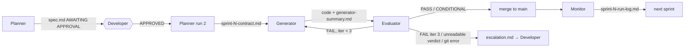

# Harness Design Brief — StoreOps (Java 21 / Spring Boot 3.5)

A Claude Code harness that takes one feature prompt to merged, gated code: **Planner → (approval) → Generator ⇄ Evaluator → Monitor**,
orchestrated by `CLAUDE.md`. Demonstrated on _shift handover bulk update_ (`PATCH /api/activities/bulk-status`): 3 sprints,
4 iterations, all merged to `main`, ≈ 4–5 % of a weekly Pro allowance. Decision IDs (D1–D19) refer to `JOURNAL.md`.



---

## A — Intent decomposition

**Agents follow the feature's lifecycle, not the code's layers.** The Planner owns _what_ (behaviour, decisions, boundaries)
and never writes code; the Generator owns _how_ for exactly one contract; the Evaluator owns _whether_, judged only from
files and its own build; the Monitor owns _what it cost and what it taught_. Each runs as a fresh subagent (D11), so no agent
inherits another's reasoning — the Evaluator sees the Generator's code and summary, never its thinking.

**Sprint boundaries.** The Planner resolved 13 open decisions (DEC-1…13: transitions, per-item vs whole-request failure,
response shape, authorization, audit exposure) _before_ any code, because each one changes what the Evaluator will test.
The feature then split into three vertical slices, each demonstrable on its own and each leaving `./mvnw verify` green:

| Sprint | Outcome                                                                                  | Why the boundary is here                                                     |
| ------ | ---------------------------------------------------------------------------------------- | ---------------------------------------------------------------------------- |
| 1      | Endpoint with per-item outcomes (NOT_FOUND / FORBIDDEN / CONFLICT), one event per update | Smallest working endpoint; holds every _per-task_ rule                       |
| 2      | Whole-request validation (1–50 items, duplicates, disallowed targets, malformed body)    | A different failure class (whole request rejected); no new storage           |
| 3      | Audit entry per update + `GET /{id}/audit` (store manager only) + `note`                 | The only new storage, model and endpoint; if it fails, 1–2 are already green |

Each sprint was capped at 6 ACs so a failed iteration is cheap. One honest trade-off: placing BLOCKED → DONE in Sprint 2 was
partly count-driven (journal 2026-10-24).

**What makes an acceptance criterion testable.** Every AC names the caller by seed user, the exact starting state, the exact
HTTP request, and in THEN the status code, exact response fields, the error `code`, the **state afterwards** and whether an
event is emitted **or not**. A `Test:` line fixes the level (Mockito unit vs MockMvc). Subjective words ("properly",
"gracefully") are banned in `sprint-decomposition`. The "state afterwards / no event" clauses matter most: they are what
client failure mode #3 (tests that assert only HTTP status) leaves out.

**Example contract entry (Sprint 1, verbatim):**

```text
AC-1.3 - A caller who is neither assignee, owner nor store manager is refused for that item
GIVEN T-1 (owner u-lead, assignee u-lead, status TODO)
WHEN u-associate sends PATCH /api/activities/bulk-status with header X-User-Id: u-associate and body
     {"updates":[{"taskId":"T-1","status":"DONE"}]}
THEN the response is 200 with updatedCount 0, failedCount 1
AND results[0] is {taskId "T-1", success false, status "TODO", errorCode "FORBIDDEN"} with a non-empty message
AND T-1 remains TODO
AND no TaskStatusChangedEvent is emitted
Test: Mockito unit (ActivityServiceTest) for the rule; MockMvc (ActivityControllerTest) for the HTTP body
Test expectations: service test asserts task still TODO (no save of changed state) and no event; controller test
asserts $.results[0].errorCode "FORBIDDEN", status "TODO", non-empty message.
```

---

## B — Governance framework

**Skill-file strategy.** Seven skills in `.harness/skills/`, each read only by the agents that need it:

| Skill                     | Read by                          | StoreOps-specific content                                                                                                             |
| ------------------------- | -------------------------------- | ------------------------------------------------------------------------------------------------------------------------------------- |
| `app-context`             | all four                         | real class names (`Project*` = programmes, `Task` = activity), seed users, 13 known baseline gaps the Planner must decide on          |
| `architecture-principles` | Planner, Generator, Evaluator    | rules R1–R5 mapped to ArchUnit tests A1–A7, each with _how it is checked_ and its _blind spot_; gate integrity; protected tests (D15) |
| `sprint-decomposition`    | Planner                          | spec/contract formats, AC rules, the baseline-gap check, ≤ 6 ACs per sprint                                                           |
| `coding-conventions`      | Generator (Evaluator: reference) | write-method prefixes A7 relies on (D7), constructor injection, records, Checkstyle rules that fail the build                         |
| `how-to-test`             | Generator (Evaluator: reference) | the four things every test asserts (status, body, state, events); named weak baseline tests "do not copy"                             |
| `how-to-review`           | Evaluator                        | 23 yes/no checks written as PASS conditions, with the evidence rule                                                                   |
| `grading-criteria`        | Evaluator                        | severities, evaluation order, weights, verdict rule                                                                                   |

The two shared files hold facts and rules **once**; agent files and other skills refer to them instead of restating them.
That choice came from experience: the first drafts of `app-context` and `architecture-principles` contained invented class
names and rules that would have failed correct baseline code — _a skill file with wrong facts is worse than none, because
agents trust it_ (journal 2026-10-21/23). Every name in a skill file is now checked against the source.

**The audit trail (`.harness/reviews/`).** Committed per iteration by the orchestrator, merged to `main` with each sprint:
spec versions (v1, v2, approved), the three contracts, `sprint-N-iter-i-generator-summary.md` and
`-evaluator-feedback.md` for **every** iteration (FAIL included), `sprint-N-run-log.md`, `usage-log.md`, and
`sprint-N-escalation.md` when one occurs. Anyone with repository access can read it; `git log` shows the decision sequence
(`sprint-1 iter-1: FAIL` → `sprint-1 iter-2: PASS` → `merge sprint-1: PASS`). A recurring quality issue surfaces through the
Monitor's signal rules: a check failing in two iterations (S1), a check that failed in an earlier sprint failing again (S2),
three iterations or an escalation (S3), or an unreadable verdict (S4) — each mapped to the skill file that owns the check
(e.g. TQ-x → `how-to-test`, SC-x → `sprint-decomposition`). Limitation found in the run: the signals fire only on FAILs, so
_weak evidence behind a PASS_ is invisible to the Monitor (see REFLECTION.md).

**One rule, and what breaks without it — R3 Error contract (failure mode #2).**
_Rule:_ controllers and services construct only `AppError` subclasses (`NotFoundError`, `ValidationError`, `ForbiddenError`,
`ConflictError`, `UnauthorizedError`); any other `Throwable` is forbidden. _Without it_, a `new IllegalArgumentException("not found")`
bypasses `GlobalExceptionHandler`'s mapping: the client gets **500 instead of 404**, and no `{"code","message"}` body —
exactly the prior experiment's failure. _Enforcement:_ ArchUnit A4 is a **whitelist** (D8): the original blacklist of four
exception types let `UnsupportedOperationException` through (sabotage test F). Its blind spot — dead code like
`if (false) throw new IllegalStateException()` is removed by javac before ArchUnit reads the bytecode (sabotage test C) —
is covered by the Evaluator's AR-2 check, which scans the diff's _source_.

---

## C — Non-determinism strategy

**Dimensions and weights.** Architecture compliance **40 %** (failure modes #1, #2, #4 — the client's main concern), Functional
correctness & tests **40 %** (the contract's ACs and failure mode #3), Code quality & coverage **20 %** (Checkstyle,
SpotBugs, JaCoCo, honesty of the generator summary). Architecture and function are equal because a correct-but-coupled
feature and a clean-but-wrong one are equally unacceptable to the standards team.

**Hard gates — one automated tool per dimension, all from the Evaluator's _own_ `./mvnw verify` run:**

| Hard gate                                                                        | Dimension      | Failure mode prevented                                                                                              | Why it cannot be a soft check                                                                                                      |
| -------------------------------------------------------------------------------- | -------------- | ------------------------------------------------------------------------------------------------------------------- | ---------------------------------------------------------------------------------------------------------------------------------- |
| ArchUnit A1–A7 (`Tests run: 7`)                                                  | Architecture   | #1 repository imports (A1, A3), #2 raw exceptions (A4), #4 calls into alerts/reports (A5), reports writing (A6, A7) | The rules are binary; an LLM reviewer can be lenient or miss an import. Each gate was proven by breaking it (sabotage A, B, D, F). |
| Tests (JUnit 5 + MockMvc)                                                        | Functional     | an AC's behaviour broken                                                                                            | A failing test is a broken requirement; no judgement can make it acceptable.                                                       |
| Checkstyle, SpotBugs, JaCoCo (service ≥ 80 %, controller ≥ 70 %, overall ≥ 70 %) | Quality        | standards drift; untested code                                                                                      | Thresholds are the client's spec (§3.6); a number either meets them or not. Checkstyle fails on any warning (sabotage G).          |
| Gate integrity GI-1…3                                                            | (precondition) | weakened gates, skipped phases, edited protected tests                                                              | If gates were weakened, every other result is untrustworthy — so FAIL without scoring.                                             |

**From variable output to a fixed verdict.** Generated code varies; the verdict must not. Five mechanisms:

1. **Checks are yes/no PASS conditions** with an observable test ("each AC's test asserts every body field, state and event
   its THEN names"), not opinions. A check that cannot be answered with evidence counts as **FAIL**.
2. **Every result needs evidence** — `file:line` and a quote for a FAIL, what was checked for a PASS.
3. **Fixed severity per check** (D12): B → FAIL, C → at most CONDITIONAL PASS, M → score only.
4. **A fixed evaluation order** (D13): integrity → hard gates → B checks → score → C checks. The weighted score is reported
   for trends but cannot hide a blocking finding.
5. **No leaked answers** (D14): worked examples in evaluator skills use invented names, after a run where the Evaluator
   grep'd for the example's real test names instead of applying the checklist.

_Evidence of determinism:_ the leaked and the clean Sprint 1 evaluations produced the same verdict, the same two findings and
the same scores (100 / 82 / 100 = 93), found independently.

**Walk-through — Sprint 1, iteration 1.** The Generator, unprompted, added `bulkUpdateWithNullItemsListIsEmptyResponse`
(null `updates` → 200 with zero counts) and an assertion comparing an immutable record's field to itself. Step 1 integrity:
PASS. Step 2 gates: BUILD SUCCESS, 78 tests, ArchUnit 7/7 — PASS. Step 3: **SC-2** (no test asserts behaviour assigned to
a later sprint) — FAIL at `ActivityServiceTest.java:331`, traced to spec DEC-2 (Sprint 2 must reject null with 400).
SC-2 is severity B → **verdict FAIL**, regardless of the 93/100 score; TQ-4 (C) is listed too. My own manual review of the
same code had said CONDITIONAL PASS — the written rule, not my judgement, is what made the result repeatable. Iteration 2
removed both; the Evaluator returned PASS (77 tests).

**Fallback when the Evaluator's own output is ambiguous.** The orchestrator routes only on the first line, which must be
exactly `VERDICT: PASS | CONDITIONAL PASS | FAIL`. Anything else triggers one Evaluator re-run with the same inputs; a second
invalid line escalates (E2). The orchestrator never interprets free text.

**Escalation path.** _Triggers:_ E1 — the third iteration ends in FAIL; E2 — the verdict line is invalid twice; E3 — a git
step fails (e.g. a merge conflict; the orchestrator never resolves one). _Output:_ `.harness/output/escalation.md`, archived
as `sprint-N-escalation.md`: sprint, trigger, iterations used, last verdict, the blocking findings with `file:line` (copied
from the last feedback), what each iteration changed, and three options. _Receiver:_ the developer, in the main Claude Code
session; the escalated sprint is never merged. _Expected response:_ `RETRY` (one more iteration, noted in the journal),
`AMEND` (the developer edits the contract's AMENDMENT block, then retry), or `STOP`. No escalation occurred in the
demonstration run; the path is specified but untested live.

---

## D — Architectural decisions

**D11 — Agents are Claude Code subagents behind thin wrappers.**
_Decision:_ definitions stay in `.harness/agents/*.agent.md`; `.claude/agents/<name>.md` holds only frontmatter (tools,
model) and one line: "read and follow the definition". _Alternatives:_ (a) `CLAUDE.md` alone, the main session playing every
role — no context reset, no enforced tool limits; (b) definitions moved into `.claude/agents/` — native, but breaks the
required `.harness/` layout. _Rationale:_ Claude Code enforces `tools` and `model` only for discovered subagents, and gives
each a fresh context — so least privilege (the Monitor has no shell; the Evaluator cannot edit code) and the
Generator/Evaluator separation are structural, not instructions. _Assumption:_ the wrapper's single instruction is followed,
and the wrapper's frontmatter is kept identical to the definition's (the wrapper is the one enforced).

**D15 — A "protected test" is test code that exists on `main`.**
_Decision:_ tests on `main` may never be changed unless the contract names the change; tests the current sprint added may be
changed to fix an Evaluator finding. Checked mechanically: `git diff --merge-base main -- src/test` must contain no removed
lines. _Alternatives:_ (a) the literal rule "no existing test changed" — deadlocked iteration 2, because fixing SC-2 meant
removing a test the Generator itself had added; (b) protecting whole files — the offending test was a new method in an
existing file; (c) allowing any change with a written justification — needs judgement and makes weakening tests easy.
_Rationale:_ sprint-owned code was never on `main`, so every removed line in that diff is protected code — no judgement
needed. In Sprint 3 the rule visibly shaped the design: the Generator kept a 2-argument constructor so protected tests
compiled unchanged. _Assumption:_ each sprint branch starts from `main` after the previous merge, and `main` is merged into it
before every iteration.

**D16 — The orchestrator commits, merges and branches; it never pushes.**
_Decision:_ after every verdict it commits code and archives on the sprint branch; on PASS it merges into local `main` and
branches the next sprint; the push is the developer's. _Alternatives:_ (b) the developer merges after each sprint — a manual
step inside the loop the PDF wants autonomous; (c) merge once at the end — Sprint 2 could then weaken Sprint 1's tests,
which are protected only once on `main` (D15). _Rationale:_ the Evaluator's verdict is the gate before `main`, the push is the
human checkpoint before the remote and CI (D19), and per-iteration commits make FAIL → fix visible in history.
_Assumption:_ an unpushed local `main` can be reset if a run goes wrong, and the main session is approved only for specific
git commands — never `push`, `reset` or a wildcard. In the run, every agent at least once tried a piped command
(`./mvnw verify | grep`, `git merge main | tail`) that would hide the exit code; rejecting them by hand worked, which is why
tool-level deny rules are the next improvement (REFLECTION.md).
