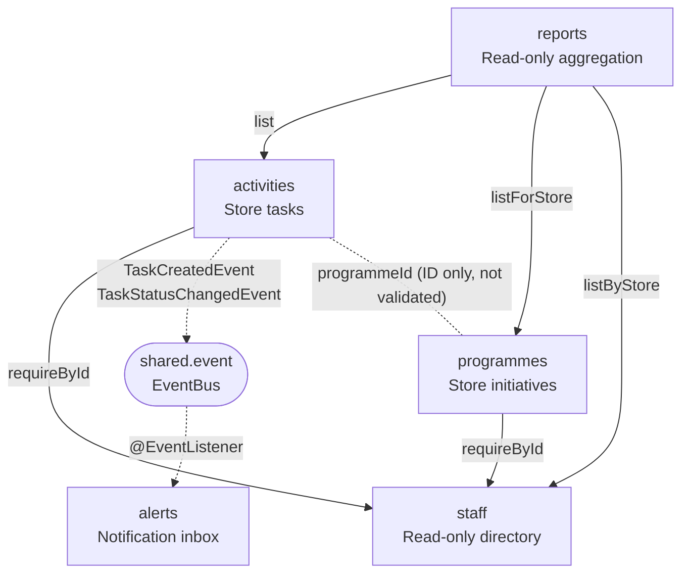

# StoreOps — Module Architecture

## Baseline (2026-10-21, commit bb2abb2)

- Solid arrow = read-only service call. Dashed arrow = event.
- Every HTTP request also calls `StaffService` via the `X-User-Id` resolver (shared.security).
- Forbidden: cross-module repository access (ArchUnit 1), activities/programmes → alerts/reports (ArchUnit 5), cycles (ArchUnit 3), reports beyond service/model (ArchUnit 6), reports writing via services (LLM review only).
